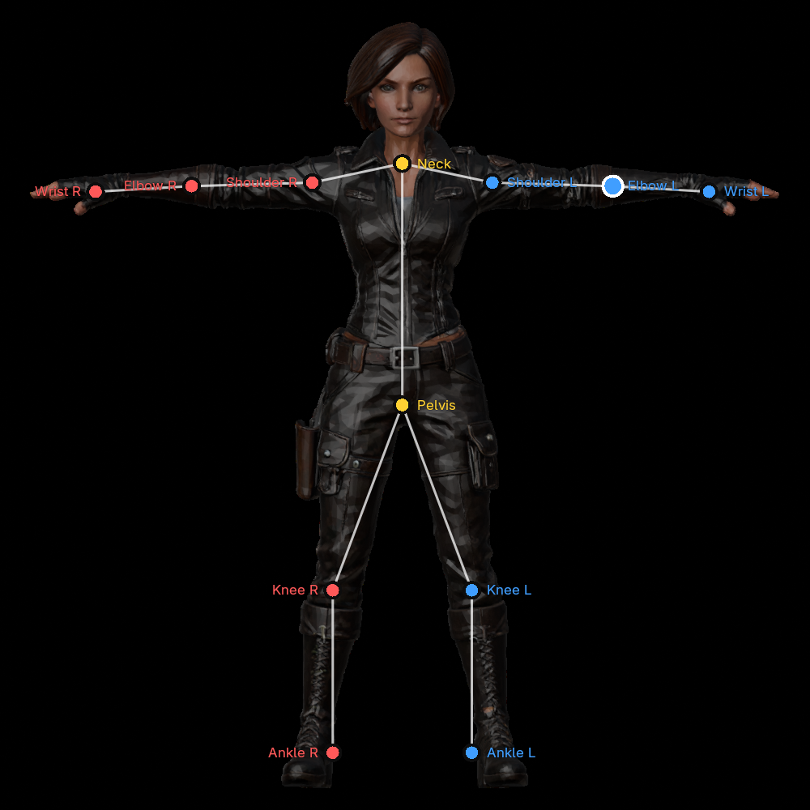
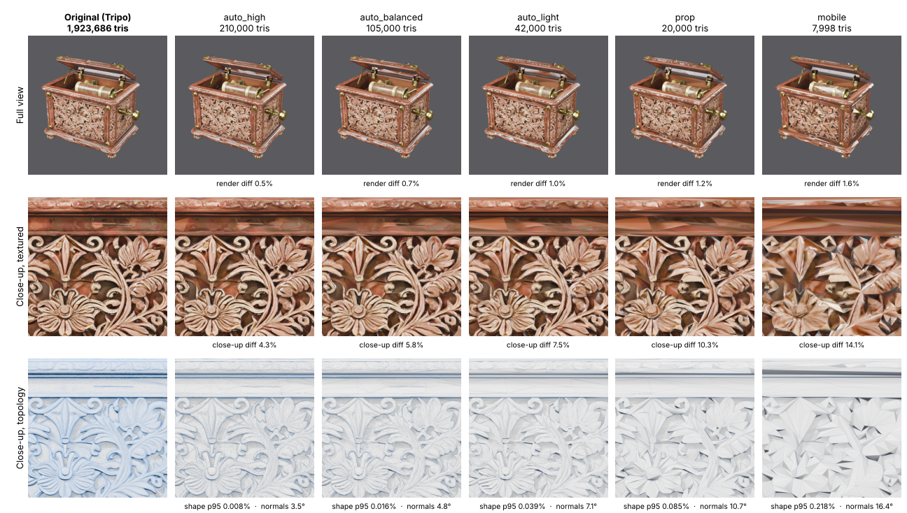
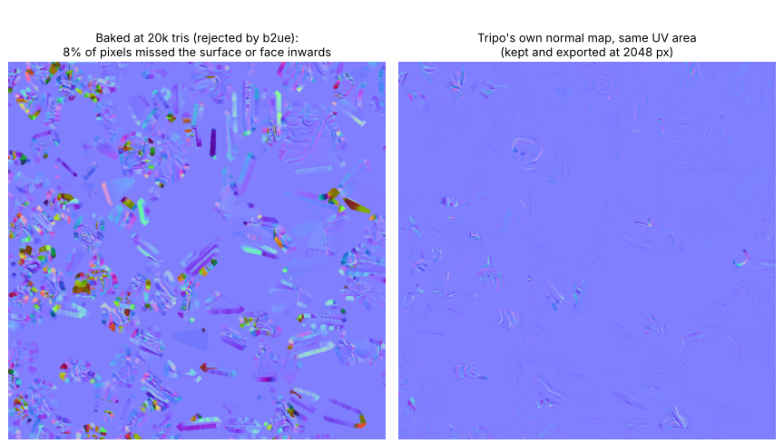
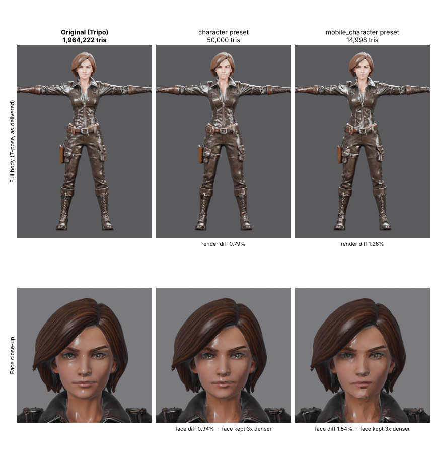
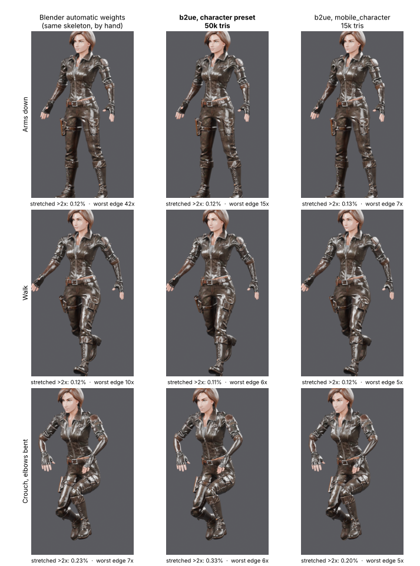
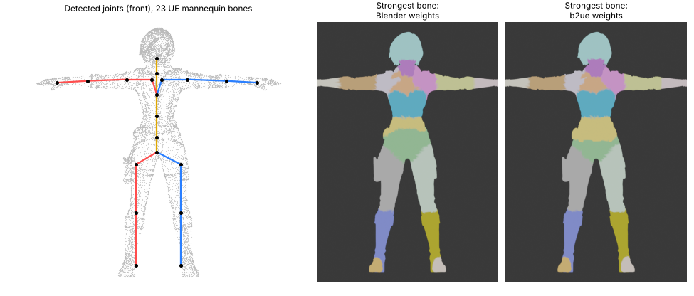
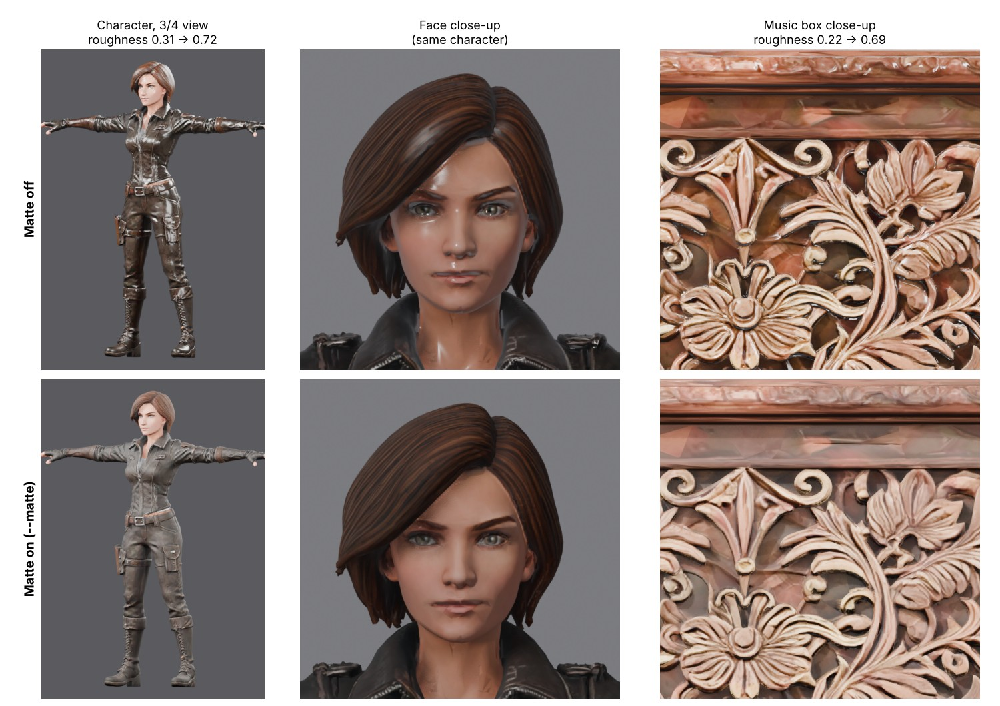

# blender-to-unreal-pipeline (b2ue)

**Turn raw 3D models, from Blender or from AI generators such as Tripo3D and Meshy, into Unreal Engine 5–ready FBX files in one step.** b2ue cleans the mesh, reduces millions of triangles to a game budget and measures what was lost. It fixes textures and scale, auto-rigs human characters with an Unreal-mannequin skeleton, and checks everything before export.

It came out of solo game development in Unreal Engine 5. The same fixes kept coming up for every asset, so they are now automated: millions of triangles, lost textures, wrong scale, unapplied rotations, flipped normals, extra leaf bones and missing skeletons.

> **Status:** early (v0.4.6). Developed and tested with Blender 5.2 (82 automated tests, plus end-to-end runs on real AI-generated models on Windows). Unreal import settings follow common UE5 practice. If an asset imports wrong in your engine version, please open an issue.

<p align="center"></p>

---

## Contents

1. [What it does](#what-it-does)
2. [Results: before and after](#results-before-and-after)
3. [Install](#install)
4. [Quick start](#quick-start)
5. [Presets](#presets)
6. [Rigging human characters](#rigging-human-characters)
7. [Options](#options)
8. [How it works](#how-it-works)
9. [Safe output](#safe-output)
10. [Importing into Unreal](#importing-into-unreal)
11. [Testing: what is verified](#testing-what-is-verified)
12. [Roadmap](#roadmap), including Claude inside Blender
13. [Contributing](#contributing)
14. [License](#license)
15. [Credits](#credits)

---

## What it does

| Problem with a raw model | What b2ue does |
|---|---|
| 1–2 million triangles | Decimates to a budget, or to the **lowest count that stays within a measured error** (`auto_*` presets), and reports the shape, shading and colour difference |
| Lumpy shading after reduction | Keeps the model's smooth custom normals through every mesh operation, and evens them out where decimation merged vertices |
| Plastic-looking shine | **Matte** option: raises the roughness of the exported textures, keeping their detail |
| Detail lost by reduction | Bakes the original surface into a normal map, **per material**, only where it helps |
| Textures packed inside GLB files, 8K–12K maps | Writes `T_<Name>_BaseColor / Normal / ORM` next to the FBX and downscales them to your limit |
| Wrong size, rotation, pivot, flipped faces | Applies transforms, scales to a real height, sets the pivot, recalculates normals |
| No skeleton | Auto-rigs human characters in **T-pose or A-pose** with 23 Unreal mannequin bones, so the IK Retargeter can use mannequin animations |
| Joints guessed wrong | **Rig markers**: drag coloured dots onto the joints in the front view, like Mixamo |
| Problems found only in Unreal | Validates UVs, materials, scale, bones and weights before export |
| Overwritten files | Never touches the source; output is all-or-nothing and never overwritten by accident |

You can use it as a **Blender add-on** (a panel in the 3D view) or from the **command line** (one file, or whole folders).

---

## Results: before and after

All numbers below were measured with the current version (Blender 5.2.2 on Windows), by b2ue's own quality report or by rendering and posing the exported files in Blender. They are not estimates. The music box was also re-run on Linux with the same results.

### 1. An AI-generated prop, start to finish

An ornate music box generated with Tripo: 1,923,686 triangles, four 4096 px PBR textures, one material. It was processed with five presets, each in one run of about a minute. Every image below is rendered in the same studio light and camera, and every number comes from b2ue's report or from comparing the renders.



| | Original | `auto_high` | `auto_balanced` | `auto_light` | `prop` | `mobile` |
|---|---|---|---|---|---|---|
| **Triangles** | 1,923,686 | 210,000 | 105,000 | 42,000 | 20,000 | 7,998 |
| Vertices | 961,707 | 104,864 | 52,364 | 20,864 | 9,864 | 3,863 |
| Reduction | | 89.1% | 94.5% | 97.8% | 99.0% | 99.6% |
| **Shape error** avg / p95 / worst | | 0.003 / 0.008 / 0.018% | 0.006 / 0.016 / 0.040% | 0.013 / 0.039 / 0.137% | 0.027 / 0.085 / 0.259% | 0.064 / 0.218 / 0.636% |
| **Normal angle** (shading) | | 3.5° | 4.8° | 7.1° | 10.7° | 16.4° |
| Colour difference (through the UVs) | | 2.0% | 2.4% | 3.2% | 4.2% | 5.4% |
| **Render difference** full view / close-up | | 0.5% / 4.3% | 0.7% / 5.8% | 1.0% / 7.5% | 1.2% / 10.3% | 1.6% / 14.1% |
| Textures (BaseColor, Normal, Roughness, Metallic) | 4 × 4096 px | 4 × 4096 px | 4 × 2048 px | 4 × 2048 px | 4 × 2048 px | 4 × 1024 px |
| Texel density | 1,275 px/m | 1,275 px/m | 638 px/m | 638 px/m | 638 px/m | 319 px/m |
| FBX size | | 18.0 MB | 11.9 MB | 5.9 MB | 3.0 MB | 1.2 MB |
| FBX + textures on disk | 187 MB (.blend, textures packed) | 31.1 MB | 16.1 MB | 10.1 MB | 7.1 MB | 2.6 MB |
| Time | | 56 s | 64 s | 55 s | 48 s | 42 s |

Kept in every output:
- **Size and pivot:** 0.98 × 0.60 × 0.83 m, pivot at the bottom centre, so it stands on the floor in Unreal.
- **Materials:** 1 material (one draw call).
- **UVs:** 1 UV map, unchanged layout, so the original textures still fit.
- **Normals:** smooth custom normals kept.
- **Validation:** no issues found.

How to read it:
- **Shape error** is the distance between the original and the reduced surface, as a percentage of the model's size. 0.01% of a 1 m box is 0.1 mm.
- **Normal angle** is how far the surface direction moved on average. This is what changes the lighting, and it degrades long before the shape does.
- **Render difference** is the mean pixel difference to the original's render. The full view is how a player sees the prop; the close-up is the carved front panel filling the screen.
- **Texel density** is texture pixels per metre of surface, measured on the original UV layout. It only changes with the texture size.

What to pick:
- **`auto_high`:** 89% fewer triangles and visually the same even in the close-up. Use it for hero props.
- **`auto_balanced`, `auto_light`:** stay close at normal viewing distance. Use them for most props.
- **`prop`, `mobile`:** fixed budgets. Fine at game distance (1.2% and 1.6% render difference), but the carving goes faceted in a full-screen close-up. The worst shape error grows fast below about 40k triangles on this model, which is where the `auto_*` presets stop.

**The bake check at work.** For the four smaller presets b2ue also baked the lost detail into a new normal map, then checked the result. On this model the carvings are so deep that at 20k triangles 8% of the baked pixels missed the surface or faced inwards. b2ue rejected the bake and kept Tripo's own normal map (resized to the preset's texture size), as the report says:

```
ornate music box 3d model: 1,923,686 -> 20,000 tris, shape off by 0.027% avg, 0.08% p95, colour 4.21%, normals 10.7°
  (tripo_mat_d90ef774: bake came out noisy (8% of pixels missed the surface or face inwards), kept the original normal map)
```



### 2. An AI-generated character, start to finish

A clothed adventurer generated with Tripo, as it came: one mesh of 1,964,222 triangles, four 4096 px PBR textures, standing in a T-pose, 0.98 units tall. Processed with the `character` and `mobile_character` presets: find the body, scale to 1.8 m, keep the face denser, reduce, rig, export.



| | Original | `character` | `mobile_character` |
|---|---|---|---|
| **Triangles** | 1,964,222 | 50,000 | 14,998 |
| Vertices | 982,107 | 24,992 | 7,491 |
| Height | 0.98 units | 1.80 m | 1.80 m |
| **Shape error** avg / p95 / worst | | 0.005 / 0.013 / 0.035% | 0.016 / 0.041 / 0.113% |
| **Normal angle** (shading) | | 5.8° | 10.1° |
| Colour difference (through the UVs) | | 1.1% | 2.0% |
| **Render difference** full body / face close-up | | 0.8% / 0.9% | 1.3% / 1.5% |
| Face | | 3× denser than the body | 3× denser than the body |
| Textures | 4 × 4096 px | 4 × 2048 px | 4 × 1024 px |
| FBX / FBX + textures | | 6.1 MB / 9.5 MB | 2.1 MB / 3.3 MB |
| Time (whole pipeline) | | 100 s | 69 s |

At 15k triangles the face still holds up at game distance, but in a full-screen close-up a shading seam shows along the jaw. Use `character` (or more triangles) for faces the camera gets close to.

The report for the `character` run:

```
  OK    humanoid     2.6s  T-pose, 1.80 m tall, face marked (57,142 verts)
  OK    decimate    35.2s  1,964,222 -> 50,000 tris, shape within 0.013% (p95), face kept 3x denser
  OK    rig          2.8s  23 bones with Unreal mannequin names, auto weights
              weights: proxy (test pose, edges stretched >2x: proxy 0.05%, heat 0.06%)
  OK    validate     0.1s  no problems found
```

**The rig.** Each column below is the same mesh posed with the same rotations. The first column is Blender's own *With Automatic Weights* on b2ue's skeleton, which is what you would do by hand. The numbers measure how much the mesh stretches: in a clean deformation edges stretch a little and evenly, while badly weighted vertices show up as edges stretched to many times their length.



| | Blender automatic weights | **b2ue `character`, 50k** | b2ue `mobile_character`, 15k |
|---|---|---|---|
| Bones | 23 (same skeleton) | 23, UE mannequin names | 23, UE mannequin names |
| Vertices without weights | 0 | 0 | 0 |
| Vertices moved by a bone on the other side | 0 | 0 | 0 |
| Most bones per vertex | 6 | 4 | 4 |
| Arms down: edges stretched >2x / worst edge | 0.12% / 42x | 0.12% / 15x | 0.13% / 7x |
| Walk | 0.12% / 10x | 0.11% / 6x | 0.12% / 5x |
| Crouch, elbows bent | 0.23% / 7x | 0.33% / 6x | 0.20% / 5x |

What this shows:
- **With the arms down and in the walk, b2ue stretches as few edges as Blender's own weights or fewer, and its worst edge is lower in every pose.** It also stays within the 4 bones per vertex that game characters are usually budgeted; Blender's weights use up to 6 and have one 42x spike with the arms down.
- In the crouch, the 50k mesh stretches more edges than Blender's weights (0.33% vs 0.23%); the 15k mesh does not (0.20%).
- b2ue computes two sets of weights and keeps the one that stretches the mesh less in a test pose (see [Rigging](#rigging-human-characters)). The report names the winner: the proxy weights for the 50k mesh, Blender's heat weights for the 15k one.



**Joints:** the shoulders sit at the arm roots, 22 cm from the centre, with elbows and wrists on the centre line of the arm. The weight maps colour each vertex by its strongest bone; both methods split the body into the same clean regions.

### 3. Matte: no more plastic shine

AI generators often give everything a low roughness, so skin, leather and wood shine like a plastic toy under a strong light. Tick **Matte (less shine)** in the add-on, or pass `--matte`, and b2ue raises the roughness of the exported textures. Dark (shiny) areas become rough, and the texture's own variation is kept, so worn spots stay rougher than polished ones.



The same models as above, rendered in the same light, with only `--matte` added. The report shows how much the roughness changed:

```
matte: T_adventurer_Roughness.jpg roughness 0.31 -> 0.72 on average
matte: T_music_box_Roughness.jpg roughness 0.22 -> 0.69 on average
```

Only roughness changes: the triangle counts, skeleton, weights, joint positions and the other textures are the same as without matte. The new roughness is `amount + (1 - amount) × old`, with `amount` 0.6 by default (`--matte-min`, **Matte amount** in the add-on). 0 changes nothing; 1 makes everything fully rough.

### 4. Rig markers, like Mixamo

When a joint is still off, you can place it yourself: coloured dots on the joints, drag them in the front view, and the other side follows. See [Rig markers](#rig-markers-fix-joints-by-hand).

---

## Install

### Blender add-on (recommended)

1. Download `b2ue-<version>.zip` from the [Releases](../../releases) page (or build it: `python tools/build_addon.py`).
2. Drag the zip into the Blender window, or use *Edit → Preferences → Get Extensions → Install from Disk*.
3. In the 3D Viewport press **N** and open the **b2ue** tab.

The add-on's manifest sets Blender 4.2 as the minimum version, but b2ue is developed and tested on Blender 5.2 only. When updating, remove the old version first.

### Command line

1. Install [Blender](https://www.blender.org/download/) 5.x.
2. Download this repository.
3. Run `b2ue.bat` (Windows) or `./b2ue.sh` (macOS / Linux).

The launcher finds Blender in `Program Files` or on your `PATH` (set `B2UE_BLENDER` to choose one). It runs Blender in the background with `--factory-startup`, so other add-ons such as Auto-Rig Pro cannot interfere.

Without the launcher:

```bash
blender -b -q --factory-startup -P b2ue/cli.py -- model.glb --preset prop

# or with the bpy module, no Blender install needed
pip install bpy
python -m b2ue.cli model.glb --preset prop
```

---

## Quick start

### In Blender

1. Optionally type an **Asset name**.
2. Pick a **Preset** (Prop, Character, Hero, Mobile, Background, Auto…) or set the options yourself.
   Tick **Matte (less shine)** if the model shines like plastic; **Matte amount** sets how much.
3. Either select objects and press **Export to Unreal**, or press **Process Files** and pick GLB / FBX / OBJ / .blend files from disk (for example straight from your Tripo or Meshy downloads).
4. The work runs in a separate Blender process. A progress bar and a checklist show each step; you can keep working or press **Cancel**. **Details** shows the full report.
5. **Created** lists the files with their triangle counts and measured quality. **Open Folder** shows them, and **Preview Result** imports them into a `b2ue preview` collection.

Your open file is never changed: the add-on saves a temporary copy and processes that.

### From the command line

Run the launcher **without arguments** and answer the questions. You can drag a file or folder into the window. At the end it prints the equivalent command, so you can repeat it without questions. Or give it everything directly:

```bat
b2ue.bat model.glb --preset prop
b2ue.bat witch.glb --preset character
b2ue.bat models\ --preset auto_balanced --out D:\Game\Import
```

The FBX files go to an `export` folder next to the input unless you pass `--out`. What you see:

```
b2ue 0.4.6  Blender -> Unreal asset pipeline
1 file  ->  D:\Models\export
preset character: humanoid, auto-rig, face x3, 50,000 tris, baked normals, 1.8 m, textures <= 2048px, matte (roughness >= 0.6)

[1/1] adventurer.blend
  OK    load         0.7s  1 mesh, 1,964,222 tris, 4 textures
  OK    cleanup     13.9s  merged 4 duplicate verts
  OK    humanoid     2.4s  T-pose, 1.80 m tall, face marked (57,142 verts)
  OK    decimate    33.6s  1,964,222 -> 50,000 tris, shape within 0.013% (p95), face kept 3x denser
              adventurer woman 3d model: 1,964,222 -> 50,000 tris, shape off by 0.005% avg, 0.01% p95, colour 1.09%, normals 5.8°
              (tripo_mat_2f253657: bake came out noisy (4% of pixels missed the surface or face inwards), kept the original normal map)
  OK    rig          2.6s  23 bones with Unreal mannequin names, auto weights
              weights: proxy (test pose, edges stretched >2x: proxy 0.05%, heat 0.06%)
  OK    validate     0.1s  no problems found
  OK    export       2.1s  1 asset
              matte: T_adventurer_Roughness.jpg roughness 0.31 -> 0.72 on average
              SK_adventurer.fbx + 4 textures (2048px)

Done in 55.4s: 1 exported
```

This is the character from the results below, run with `b2ue.bat adventurer.blend --preset character --matte` (file name and paths shortened).

Blender's own log lines are kept out of the way. If a file fails, the last lines of the log are shown and the full log path is printed. `--verbose` shows everything.

---

## Presets

| Preset | For | Settings |
|---|---|---|
| `prop` | everyday objects | 20k tris, 2048 px, baked normals |
| `hero` | close-up assets | 100k tris, 4096 px, baked normals |
| `background` | far away scenery | 3k tris, 1024 px |
| `mobile` | mobile games | 8k tris, 1024 px, baked normals |
| `character` | human characters (T/A-pose) | auto-rig, keep face detail, 50k tris, 1.8 m, 2048 px, baked normals |
| `mobile_character` | human characters for mobile | auto-rig, keep face detail, 15k tris, 1.8 m, 1024 px, baked normals |
| `creature` | animals, monsters, non-human characters | 60k tris, 2048 px, baked normals, no rig |
| `auto_high` | when quality matters most | lowest tris with shape error ≤ 0.01% (p95) and ≤ 0.05% (worst), max 300k, 4096 px |
| `auto_balanced` | a good default for unknown models | lowest tris with shape error ≤ 0.02% / 0.10%, max 150k, 2048 px |
| `auto_light` | game-ready, lighter | lowest tris with shape error ≤ 0.05% / 0.30%, max 60k, 2048 px |

"Baked normals" means *allowed*: the bake runs only where it helps (see [How it works](#how-it-works)). Any option you pass overrides the preset, e.g. `--preset character --height 1.65 --no-keep-face`.

---

## Rigging human characters

With `--human` (or `--preset character`) b2ue expects **one human standing upright in a T-pose or A-pose**, with arms between horizontal and 60° below it. This is how Tripo, Meshy and similar tools deliver characters. Animals, creatures and other poses are not rigged; use `--preset creature` for those.

Steps:
1. **Join and orient.** Joins the character's meshes into one, turns it to face the front (it checks where the toes and arms point), and puts the feet on the origin.
2. **Scale** to `--height`.
3. **Find the joints.**
   - The crotch, neck and legs are found from horizontal slices of the body.
   - Each arm is traced from the fingertip towards the body. Every few centimetres b2ue cuts a slice across the arm and moves to its centre, and it stops where the arm meets the torso: where the slice suddenly widens, or at the latest at the side of the chest at armpit height (T-pose sleeves can widen too gradually to notice). Shoulder, elbow and wrist are placed on that centre line with average human arm proportions, and centred front to back.
   - Left and right are averaged, because people are close to symmetric.
4. **Face detail** (`--keep-face`). Marks the front of the head, so decimation keeps `--face-detail` times more triangles there.
5. **Rig** (`--rig`). Builds 23 bones with Unreal mannequin names: `root`, `pelvis`, `spine_01`–`03`, `neck_01`, `head`, `clavicle`, `upperarm`, `lowerarm`, `hand`, `thigh`, `calf`, `foot`, `ball`. Then it skins the mesh:
   - computes two sets of weights: heat weights on a watertight voxel copy, transferred and smoothed, and Blender's own heat weights on the mesh. The voxel copy is there for characters made of many separate pieces (eyes, lashes, boots, clothes), where Blender's heat weights often fail
   - gives any vertex still without weights its nearest bone, and limits each vertex to 4 bones
   - poses both in a test pose and keeps the one that stretches the mesh less (the report says which)

### Rig markers: fix joints by hand

Mixamo and Auto-Rig Pro let you put circles on the chin, elbows, wrists and knees. b2ue's markers work the same way:

1. In the b2ue panel tick **Humanoid (T/A-pose)** and **Rig**, then press **Place Rig Markers**.
   - **12 coloured dots** appear on the joints b2ue detected: neck, pelvis, shoulders, elbows, wrists, knees and ankles. Blue is left, red is right, yellow is the middle.
   - White lines between them preview the skeleton.
   - The view turns to the front of the character, orthographic.
2. **Click a dot and drag it** (or press **G**) onto the joint. You only need the front view:
   - **Depth is automatic.** On export each marker is moved to the middle of the body, front to back, so a marker floating in front of the arm is fine.
   - **Mirror** (on by default) works like Auto-Rig Pro's and Mixamo's symmetry: move the right shoulder and the left shoulder follows, and the other way round. Neck and pelvis stay on the middle line. Turning Mirror on copies the selected marker's side onto the other side.
3. Export as usual. The markers are saved in the .blend file, so the command line uses them too. They are never exported.

| Button | Action |
|---|---|
| **Place Rig Markers / Reset Rig Markers** | Put the markers on the detected joints (again) |
| **Front View** (square icon) | Look at the character from the front |
| **X** | Remove the markers and go back to automatic detection |
| **Mirror** | Keep left and right symmetric while you move them (switching it on makes them symmetric at once) |

Markers override detection for their joints; the spine, head, hands and feet follow them. If detection fails (for example arms close to the body), *Place Rig Markers* puts the dots at average human proportions. Once all 12 are placed, the character is rigged anyway.

**Limits:**
- no finger, face or jaw bones (hands move as one piece)
- models that already have a skeleton are left as they are
- automatic weights are a starting point; check shoulders and hips in Blender for close-up characters
- in Blender, imported FBX bones can look too long. FBX stores where each bone starts, not how long it is, so Blender's importer guesses: the `root` bone reaches all the way to the pelvis (a 1 m bone lying backwards on the floor) and hand bones can pass the fingertips. Unreal uses only the joint positions, and the root keeps the same orientation as the UE mannequin's. **Preview Result** shortens the root for display

---

## Options

**Asset type**

| Option | Description |
|---|---|
| `--preset NAME` | Start from a preset |
| `--name NAME` | Name of the exported files for a single model (`SM_NAME.fbx`) |
| `--human` / `--no-human` | The model is a human character in T-pose or A-pose |
| `--rig` / `--no-rig` | Auto-rig a human that has no skeleton (implies `--human`) |
| `--keep-face` / `--no-keep-face` | Keep more triangles on the face when decimating (implies `--human`) |
| `--face-detail X` | The face keeps X times more of its triangles than the body (default 3) |

**Geometry**

| Option | Description |
|---|---|
| `--target-tris N` | Decimate meshes above N triangles down to about N (UVs, normals and skin weights are kept) |
| `--quality high\|balanced\|light` | Pick the lowest triangle count within that shape error; `--target-tris` becomes the upper limit |
| `--max-tris N` | Warn above N triangles (default: the target) |
| `--height M` | Scale the model to M metres tall (AI models are often about 1 unit) |
| `--origin bottom\|center\|object\|keep` | Pivot of static meshes (default `bottom`: stands on the floor) |
| `--drop-shape-keys` | Remove shape keys (morphs) so those meshes can be decimated. By default meshes with shape keys keep full detail and a warning says so |
| `--bake-normals` / `--no-bake-normals` | Bake detail lost by decimation into normal maps, per material, where it helps |
| `--bake-size N` | Size of baked normal maps (default 2048; 4096 needs about 2 GB more memory) |
| `--no-measure` | Skip the shape/colour measurement |
| `--triangulate` | Triangulate before export |
| `--merge-distance D` | Vertex merge distance (default `1e-5`) |
| `--no-cleanup` | Skip cleanup |

**Output**

| Option | Description |
|---|---|
| `--out DIR` | Output folder (default: `export` next to the input) |
| `--texture-size PX` | Downscale textures larger than PX (e.g. `2048`) |
| `--matte` | Less shine: raise the roughness of exported textures and materials (see [Results 3](#3-matte-no-more-plastic-shine)) |
| `--matte-min R` | How matte, 0–1 (default 0.6): new roughness = R + (1 − R) × old |
| `--embed-textures` | Put textures inside the FBX instead of next to it |
| `--overwrite` | Replace output files that already exist (source files are never replaced) |
| `--strict` | Skip assets with errors and exit with code 1 (useful in CI) |
| `--recursive` | Include subfolders |
| `--report FILE` | Also write a JSON report (all measurements included) |
| `--verbose` | Show Blender's own output |

`b2ue validate <input>` runs the checks without writing anything.

Memory: the 1.9M-triangle music box with four 4096 px textures peaked at 4.2 GB with `auto_high` and 4.7 GB with `prop` (which runs a bake). Plan for 8 GB of RAM for models of this size.

---

## How it works

For each input file:

1. **Load.** Opens a `.blend`, or imports `.glb` / `.gltf` / `.obj` / `.fbx` into an empty scene.
2. **Clean up.**
   - Unparents meshes from helper empties (common in GLB files from AI tools) and applies rotation and scale.
   - Merges duplicate vertices, removes loose geometry and recalculates normals.
   - Keeps custom normals throughout. After decimation, the corners around each merged vertex are made to agree: corners within 20° of their vertex's average are averaged, so skin does not look patchy, while creases and carvings (larger angles) stay sharp.
3. **Human / scale.** See above; `--height` also works for props.
4. **Decimate** to `--target-tris`, or step down while the measured error stays within the `--quality` limit.
   - Shape keys (morphs) block decimation in Blender. Those meshes are kept at full detail unless you pass `--drop-shape-keys`.
5. **Bake** the lost detail into normal maps, one image per material, because the materials of a character (skin, eyes, lashes, clothes) usually share the same UV square. The bake is skipped when the reduced mesh already shades within 4° of the original. A material keeps its own normal map when:
   - its UVs overlap themselves (mirrored or stacked islands, eyelash cards)
   - its own map would be exported sharper than the bake (a 4096 px map exported at 2048 px is no sharper than a 2048 px bake, so that one is baked)
   - after baking, more than 3% of its pixels missed the surface or point inwards (see the music box above)

   The report says what happened for every material.
6. **Rig** humans.
7. **Validate:**

   | Code | Level | Meaning |
   |---|---|---|
   | `NO_UV` | error | No UV map |
   | `NO_FACES` | error | Mesh has no faces |
   | `NEGATIVE_SCALE` | error | Negative scale, flips normals |
   | `MULTIPLE_ROOT_BONES` | error | Unreal needs a single root bone |
   | `SKINNED_NO_WEIGHTS` | error | Armature modifier but no vertex groups |
   | `NO_BONES` | error | Empty armature |
   | `UNAPPLIED_TRANSFORM` | warning | Rotation/scale left unapplied (skinned or shared meshes) |
   | `NGONS` | warning | Faces with more than 4 vertices |
   | `TRI_BUDGET` | warning | Over the triangle budget |
   | `NO_MATERIAL` / `EMPTY_MATERIAL_SLOT` | warning | Missing materials |
   | `MISSING_TEXTURE` | warning | A material uses an image that cannot be loaded |
   | `SKINNED_NOT_PARENTED` | warning | Skinned mesh not parented to its armature |
   | `ARMATURE_SCALE` | warning | Armature object scale is not 1 |

8. **Export** one FBX per asset:
   - An armature plus the meshes it deforms becomes `SK_<Name>.fbx`.
   - Every other top-level mesh becomes `SM_<Name>.fbx`, with its pivot set by `--origin`.
   - A file with a single asset is named after the source, e.g. `automaton.glb` → `SM_automaton.fbx`.
   - Textures are written next to the FBX as `T_<Name>_BaseColor`, `_Normal`, `_ORM` and so on, with relative paths. AI tools pack textures inside GLB files; without this step the FBX would point to files that do not exist.
   - With `--matte`, roughness maps (the G channel of an ORM map) and roughness values of materials are raised after resizing.

FBX settings: *Apply Scalings: FBX All*, forward `-Z`, up `Y`, face smoothing, tangent space, **no leaf bones**, bone axes Y/X, armature exported as a null node (`UNREAL_FBX_SETTINGS` in `b2ue/export.py`).

---

## Safe output

- **Existing files are kept.** If an output file already exists, that source file fails with a clear message and nothing is written. Use `--overwrite` (or *Overwrite existing* in the add-on) to replace it.
- **Source files are never replaced**, not even with `--overwrite`.
- **One owner per file.** Two inputs that would produce the same FBX name are refused before any work is done. Objects whose names clean up to the same file name get a short, stable suffix.
- **All or nothing.** Files are written to a hidden `.b2ue-staging-*` folder first and moved into place only when the whole source file succeeded. A failed or cancelled run leaves the output folder as it was.
- **Unsaved texture edits are exported** with their current pixels, without saving or changing your images.

---

## Importing into Unreal

1. Keep the FBX and its `T_` textures in the same folder and drag the FBX into the Content Browser.
2. Unreal creates a material with the base colour and normal map connected.
3. FBX cannot carry channel-packed maps, so connect `T_<Name>_ORM` yourself: **G → Roughness, B → Metallic**. R is ambient occlusion when present (the glTF layout).
4. Import `SK_` files as Skeletal Mesh and let Unreal create a new skeleton. The bone names match the UE mannequin, so the IK Retargeter can map mannequin animations onto it.

Decimation is a quick automatic reduction. It works well for props, background assets and characters at game distance. For hero assets close to the camera, manual retopology plus a baked normal map is still better, because automatic decimation does not create clean edge flow for animation.

---

## Testing: what is verified

```bash
pip install bpy pytest
python -m pytest tests
```

The 82 tests build messy sample scenes and run the whole pipeline:
- duplicate vertices, flipped faces, rotated and scaled objects
- GLB files with packed textures, shape keys, rigs
- humans in T-pose and A-pose facing different directions
- materials sharing UV space, mirrored UVs

They then re-import the exported FBX files and check:
- size, pivot, normals and textures
- bone names, skin weights and face detail
- joints on the arm's centre line
- marker mirroring (also after opening a file, and for markers saved without a symmetry plane), and that marker depth does not change the rig
- per-material baking and the bake checks
- smooth normals after decimation
- matte: roughness goes up and keeps its detail, and nothing changes without it
- safe output

Also verified for this release:
- the add-on zip installs into a clean Blender user folder
- full runs on Windows with Blender 5.2.2: a 1.9M-triangle AI-generated prop with five presets and a 2M-triangle AI-generated character with two presets and three test poses, both also with `--matte` (the report lines, renders and tables above)
- the marker overlay is drawn with the add-on's own GPU code (the screenshot at the top)

Not covered by the automated tests: importing into Unreal Engine itself (the FBX settings follow common UE5 practice) and running the add-on on macOS.

---

## Roadmap

- Unreal-side batch import script (Editor Python, `AssetImportTask`) that also wires the ORM texture
- Convex collision (`UCX_`) for props
- Finger bones for humans
- Weight checks per body part, with a strict mode that refuses bad rigs

### Planned: Claude inside Blender

**Not built yet.** The next big step is connecting the add-on to the [Claude API](https://docs.claude.com), so you can work with b2ue by typing a request in the Blender panel:

- **Prompt to model.** Type what you need, for example *"a wooden crate with iron corners, 1 m wide, game-ready"*. Claude writes the Blender Python that builds it (mesh, UVs, materials), Blender runs it, and the result goes through the same pipeline as every other model: cleanup, measurement, validation and export, with the same report.
- **Prompt to fix.** *"Make it less shiny"*, *"the left shoulder is too low"*, *"lighter for mobile"*: Claude turns the request into b2ue options or moves the rig markers, and shows the change before applying it.
- **Explain the report.** Validation issues and quality numbers explained in plain language, with a proposed fix.

How it is meant to work:
- You use your own API key, stored in the add-on preferences. Nothing is sent unless you press the button.
- Generated code is shown to you before it runs, and it runs in the separate background Blender process b2ue already uses, never in your open file.
- Expected limits: models built from code suit hard-surface props, blockouts and procedural objects. Organic characters will still come out better from dedicated 3D generators such as Tripo, which b2ue already prepares for Unreal.

See [CHANGELOG.md](CHANGELOG.md) for what changed in each version.

---

## Contributing

Bug reports with a model that fails are very welcome. Please attach the JSON report. See [CONTRIBUTING.md](CONTRIBUTING.md) for how to run the tests and where things are in the code. The test suite also runs on GitHub Actions for every push and pull request (`.github/workflows/tests.yml`).

---

## License

GPL-3.0-or-later. See [LICENSE](LICENSE).

The code uses Blender's Python API, so it follows Blender's GPL licensing for scripts and add-ons. The license applies to this tool only: the models, FBX files and games you make with it are yours.

---

## Credits

Created by Abdulkerim Tabakoğlu.

**Built with [Claude](https://www.anthropic.com/claude).** This project was developed together with Claude, Anthropic's AI assistant. Claude contributed in several areas:
- the code
- the tests and measurements
- the debugging on real models: custom normals, the per-material bake, the arm tracing, the rig markers, the matte option
- this documentation

The design decisions, testing on real assets and final review are by the author.
